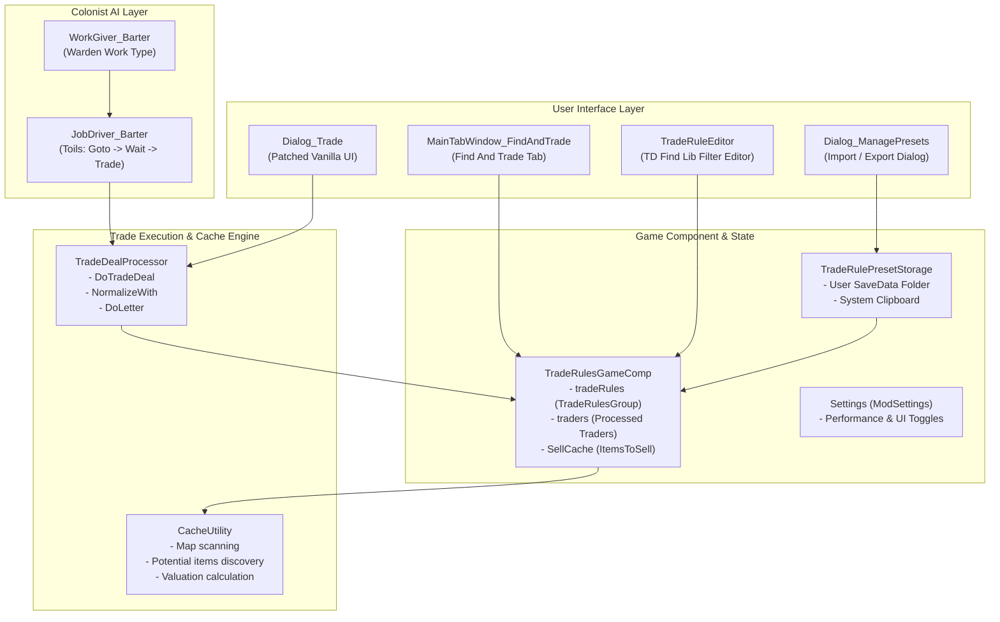
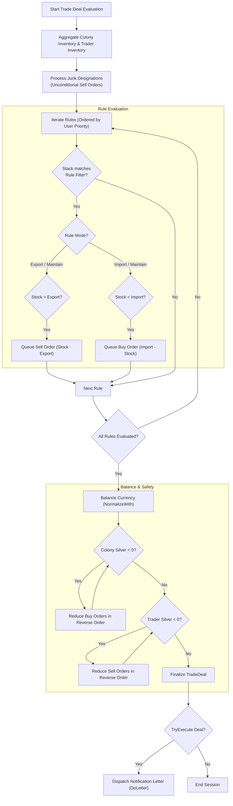

# Find / Trade Mod Specification

## 1. Overview & Identity

| Attribute | Details |
| :--- | :--- |
| **Mod Name** | Find / Trade (internally referenced as `MGAutoSell`) |
| **Package ID** | `Memegoddess.FindAndTrade` |
| **Author** | Meme Goddess |
| **Supported Game Versions** | RimWorld 1.6, 1.7 |
| **Dependencies** | `brrainz.harmony` (Harmony), `Memegoddess.TDFindLib` (TD Find Library) |
| **Core Purpose** | Automates colony commerce by pairing advanced item filtering (`TD Find Library`) with customizable trade rules (Export, Import, Maintain), automated colonist barter AI, manual trade UI pre-filling, and cross-save preset management. |

---

## 2. Core Functional Concepts

### 2.1 Trade Rules & Modes
A **Trade Rule** (`TradeRule`) combines a search filter (`TradeQuerySearch`) with trading thresholds and an operational mode:

- **Export Mode (`TradeMode.Export`)**:
  - Automatically sells matching colony items down to the specified export threshold (`Export`).
  - If `Export == 0` (or unconfigured), all matching items are marked for liquidation.
  - Sells only if the visiting trader or trade ship has sufficient silver (balanced automatically).
- **Import Mode (`TradeMode.Import`)**:
  - Automatically purchases matching items from traders up to the target stock quantity (`Import`).
  - Purchases only if the colony has sufficient available silver.
- **Maintain Mode (`TradeMode.Maintain`)**:
  - Maintains inventory within a defined range: `[Import, Export]`.
  - Buys when colony stock drops below `Import`; sells when colony stock exceeds `Export`.
  - Constraint: `Import <= Export` must hold; otherwise, the rule is flagged invalid.

### 2.2 Aggregation Modes (`TradeRuleAggregation`)
Rules can aggregate matched item quantities in two ways:
- **`ThingDef` (Per Item Def)**:
  - Thresholds apply individually to each unique `ThingDef` matching the query.
  - *Example*: A rule matching all raw vegetables will maintain 100 Potatoes, 100 Corn, and 100 Rice independently.
- **`Rule` (Total Rule Aggregate)**:
  - Thresholds apply to the sum of all items matching the rule across different `ThingDef`s.
  - *Example*: A rule matching recreational drugs will maintain a total combined pool of 50 units (e.g., 20 Beer + 30 Psychite Tea).

### 2.3 Direct Junk Designation
- Allows players to designate items on the map as **Junk** using the `Junk` designator (`Designator_AutoSell`) or reverse gizmo.
- Marked items (`MGDesignatorDefOf.MGAutoSell`) are sold unconditionally during trade before applying general rule evaluations.

### 2.4 Automatic Trade Execution vs. Assisted Manual Trading
The mod supports two complementary workflows:
1. **Fully Autonomous Pawn AI (`WorkGiver_Barter` / `JobDriver_Barter`)**:
   - Colonists assigned to the `Warden` work type autonomously initiate trade dialogs with arriving caravans or orbital trade ships (via `Building_CommsConsole`).
   - Executes trade orders automatically without player intervention, sending a detailed recap letter.
2. **Semi-Automated Manual Trading (`DoTradeOnOpen`)**:
   - When the player manually opens the vanilla trade dialog (`Dialog_Trade`), the mod immediately pre-populates purchase and sale sliders according to the active rules.
   - Trade rows display visual tags indicating which rule prompted the transaction (e.g., `- (Organs)`).

---

## 3. System Architecture & Component Design

### 3.1 Architecture Overview

### 3.2 Key Classes and Responsibilities

| Class | Location | Primary Responsibility |
| :--- | :--- | :--- |
| `Mod` | `Source/Mod.cs` | Mod initialization, Harmony patch application, settings registration. |
| `Settings` | `Source/Settings.cs` | Mod configuration (scanEveryStack, UI toggles, dev-mode benchmarks). |
| `TradeRulesGameComp` | `Source/TradeRulesGameComp.cs` | World/game component managing persisted rules, processed traders, and map cache schedules. |
| `TradeRule` | `Source/Filter/TradeRule.cs` | Data model for a single trade rule (query search, import/export counts, mode, aggregation). |
| `TradeRulesGroup` | `Source/Filter/TradeRulesGroup.cs` | Ordered collection of trade rules inheriting `TD_Find_Lib.SearchGroupBase<TradeRule>`. |
| `TradeRuleEditor` | `Source/Filter/TradeRuleEditor.cs` | Sub-window leveraging TD Find Library's query builder to customize filters. |
| `TradeDealProcessor` | `Source/TradeDealProcessor.cs` | Core algorithm evaluating colony inventory against rules, building buy/sell lists, balancing funds, and executing deals. |
| `CacheUtility` | `Source/CacheUtility.cs` | High-performance map item scanner, pricing calculator, and potential item resolver. |
| `MainTabWindow_FindAndTrade` | `Source/MainTabWindow_FindAndTrade.cs` | Primary game tab displaying rules list, previewing items to sell, and configuring auto-trading pawns. |
| `TradeRulePresetStorage` | `Source/Presets/TradeRulePresetStorage.cs` | Manages preset XML files on disk (`SaveData/TradeRulePresets`) and clipboard serialization. |
| `WorkGiver_Barter` | `Source/AI/WorkGiver_Barter.cs` | Scanner identifying unhandled visiting traders or orbital ships for assigned colonists. |
| `JobDriver_Barter` | `Source/AI/JobDriver_Barter.cs` | Pawn job executing the actual barter interaction at pawn touch or comms console. |

---

## 4. Trade Execution Algorithm (`TradeDealProcessor`)

The transaction builder executes through structured evaluation stages:

### 4.1 Stack Splitting (`scanEveryStack`)
- When enabled in settings, the mod inspects **every individual stack** in a `Tradeable` row against the rule rather than checking only the first item.
- If a pile contains mixed stacks (e.g., tainted vs. untainted apparel, different quality tiers), the mod splits the `Tradeable` into matching and non-matching instances so only target items are bought or sold.

### 4.2 Over-Budget Normalization (`NormalizeWith`)
- **Colony Protection**: Prevents colonists from buying items if they lack sufficient silver. Excess purchases are trimmed backwards from the lowest-priority rule.
- **Trader Protection**: Prevents selling more goods than the trader can afford in silver, avoiding selling items for zero return.

---

## 5. User Interface & Controls

### 5.1 Main Tab Window (`MainTabWindow_FindAndTrade`)
Divided into two vertical panels:
- **Left Panel (Tabs)**:
  - **Rules Tab**: Displays all configured rules with drag-handle reordering, name, trash icon, edit button, enable/suspend toggle, Export input box, Mode switcher (`Export` / `Import` / `Maintain`), and Import input box.
  - **Edit Tab**: Opens `TradeRuleEditor` allowing comprehensive filter setup using TD Find Library queries (Def, quality, hit points, trade price categories, stuff, etc.).
  - **Settings Tab**: Toggles `autoTrade` globally and lists colonists with their trade price improvement stats and Ideology roles, allowing users to designate specific negotiators.
- **Right Panel (Sell Panel)**:
  - Shows real-time preview of items queued for sale on the current map.
  - Lists item icons, stack counts, unit prices, and total expected silver return.
  - Displays potential matching items for buy rules.
  - Shows designated seller with Social skill trade price improvement bonus.

### 5.2 Presets Management Window (`Dialog_ManagePresets`)
- Accessible via the book icon in the title bar of the Rules tab.
- **Save**: Saves active rules to an XML file in `RimWorld/TradeRulePresets`.
- **Load (Replace)**: Replaces all active rules with preset contents.
- **Load (Append)**: Appends preset rules to existing rules.
- **Clipboard**: Copy to or paste from clipboard in XML format.
- **Delete**: Deletes saved preset files.
- **Isolation Guarantee**: Trader assignments and colony pawn references are never saved in presets, ensuring portability across save files.

---

## 6. Mod Integrations & Extensibility

1. **TD Find Library (`Memegoddess.TDFindLib`)**:
   - Provides core filtering logic.
   - Custom queries added by Find / Trade:
     - `MGAutoSell_Query_TradePriceAmount`: Filter by actual trade price value.
     - `MGAutoSell_Query_TradePrice`: Filter by price category (`PriceType`).
     - `MGAutoSell_Query_TraderKind`: Filter by trader kind (`TraderKindDef`).
     - `MGAutoSell_Query_TraderOrbital`: Check if trading entity is an orbital trade ship.
2. **RimWorld Ideology**:
   - Accounts for Ideological roles (Leader bonus) and social product price modifiers (e.g., `DrugSellPriceImprovement`, `AnimalProductsSellImprovement`).
3. **RimWorld Odyssey / Shuttles (Experimental `FF_Shuttles`)**:
   - Contains scaffolding (`SettlementTracker`, `InProgressRoute`) to compute autonomous trading shuttle routes to world map settlements based on fuel requirements and silver reserves.

---

## 7. Performance & Caveats

- **Map Caching Interval**: Map inventory scanning (`CacheUtility.Cache`) is throttled to run every `2500 / Max(maps, 1)` ticks to prevent frame-rate drops.
- **Benchmarking Tool**: Includes an integrated profiler accessible in Dev Mode to benchmark map item search, junk resolution, rule matching, trader selection, and cache assembly.
- **Colonist Work Priority**: Automated bartering is classified under the `Warden` work type (`priorityInType = 90`). Colonists must have both `Talking` and `Manipulation` capacities enabled.
